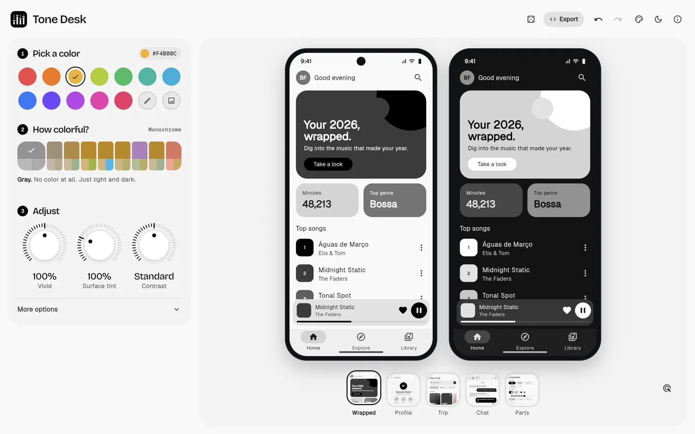
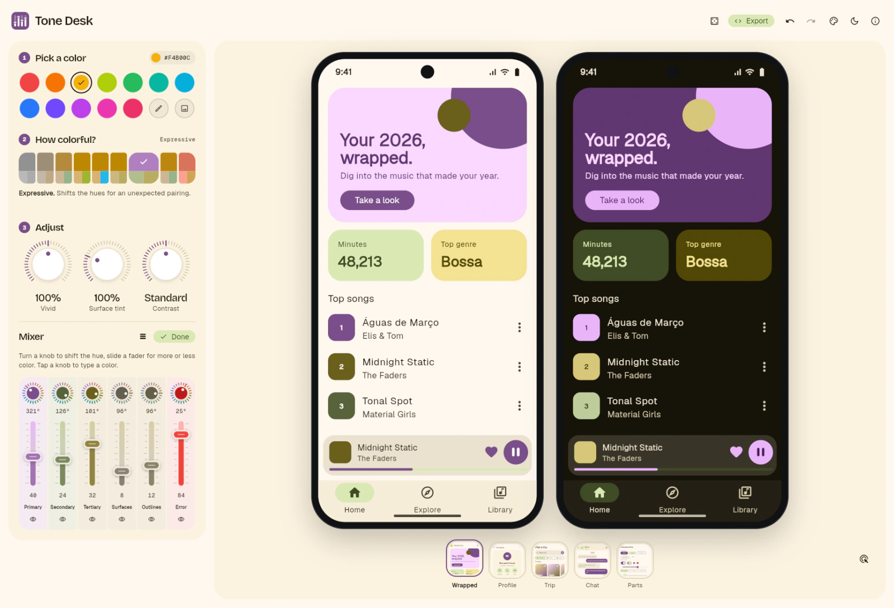
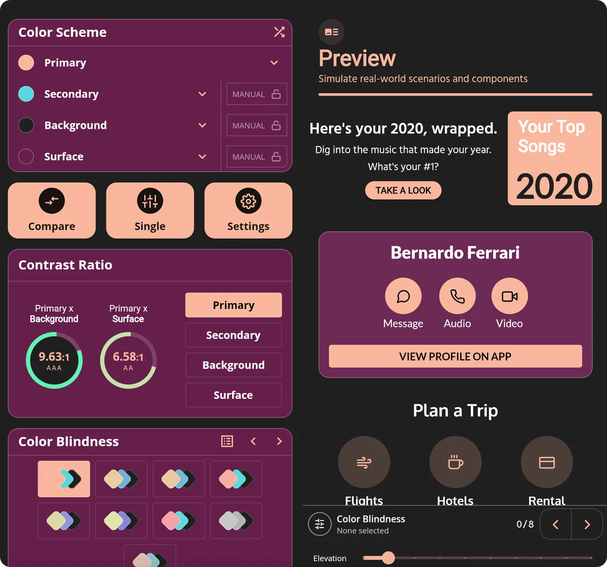

<p align="center">
  
</p>

<h1 align="center">Tone Desk</h1>

<p align="center"><strong>Make a Material 3 theme in three steps.</strong></p>

<p align="center">Pick a color, choose how colorful it gets, and turn three knobs. Every screen in the preview wears your theme while you do it.</p>

<p align="center"><a href="https://bernaferrari.github.io/tone-desk/"><strong>Open Tone Desk ↗</strong></a></p>

<p align="center">
  
</p>

## Three steps, no manual

1. **Pick a color.** Tap one of twelve presets, type a hex, or pull a color from a photo.
2. **How colorful?** One strip runs from calm to colorful through Material's nine dynamic color styles. Each comes with a plain name, like *Balanced* (Android's default) or *Wild*, instead of a spec term.
3. **Adjust.** Turn **Vivid** for more or less color, **Surface tint** for how much of it reaches the backgrounds, and **Contrast** from soft to high.

The preview is real Material 3 widgets on five screens: a music recap, a profile, a trip planner, a chat and a sheet of components. Turn on the inspector (**I**) and hover anything to see which color role paints it.

## The mixer, for brand colors

<p align="center">
  
</p>

Open **More options** when a brand needs its own colors. Each of the six tonal palettes (primary, secondary, tertiary, surfaces, outlines and error) gets its own channel strip, like a mixing desk:

- **Turn the knob** to shift its hue, and **slide the fader** for more or less color.
- **Tap the knob** to type a brand color or dial one in. Its hue and colorfulness set the palette, and each role keeps Material's lightness, so text on it stays readable.
- **Tap the eye** to turn a palette gray and see what it paints.
- **Lay the strips down** as rows, from the button beside Done, for longer faders.

A palette drives a family of roles: primary also sets `onPrimary`, `primaryContainer`, `inversePrimary` and the fixed colors. Hover a strip's name to see them all.

## Take it with you

**Export** (**E**) writes the theme for Flutter (`ThemeData` for light and dark), CSS custom properties with `light-dark()` in OKLCH, Tailwind v4, or W3C design tokens. When nothing is mixed, the Flutter export is the one-line `ColorScheme.fromSeed` call that rebuilds it.

Press **Space** to roll a new seed (your style and knobs stay), **D** to flip the studio between light and dark, **C** to see every color role, and **⌘Z** to undo.

## Run from source

Tone Desk uses Dart's primary constructors, so it needs Flutter's `main` channel (the CI pins the exact revision in [`.github/workflows/pages.yml`](.github/workflows/pages.yml)).

```sh
git clone https://github.com/bernaferrari/tone-desk.git
cd tone-desk
flutter channel main && flutter upgrade
flutter pub get
flutter run -d chrome
```

It also runs on macOS, Android and iOS. Check changes with `flutter analyze` and `flutter test`; every push to `main` deploys the web app to GitHub Pages. The icons are drawn once in [`docs/brand`](docs/brand) and generated for every platform with `npx screenshot-studio icons docs/brand/icon.json`.

## History

<p align="center">
  
  <br><sub>Color Studio in 2020. The wrapped card is still there.</sub>
</p>

Tone Desk started in 2019 as Color Studio. Material Design Components for Android had just shipped [dark theme support](https://github.com/material-components/material-components-android/releases/tag/1.1.0-alpha06), with a twist: surfaces got a white overlay as they rose, which broke half of [ChangeDetection](https://github.com/bernaferrari/ChangeDetection) overnight. Picking colors that worked in light and dark became trial and error, so I built a tool that wore the theme while you made it.

Material has since moved to dynamic color, where one seed grows a whole scheme. Tone Desk is the rewrite for that world: fewer panels, plainer words, and the same idea of seeing your colors on real screens. The faders in its icon are Color Studio's, now in color.

## Feedback

Design suggestions, bug reports and pull requests are welcome in [issues](https://github.com/bernaferrari/tone-desk/issues). Tone Desk keeps everything on your device; see the [privacy policy](privacy_policy.md).

[Apache License 2.0](LICENSE)
